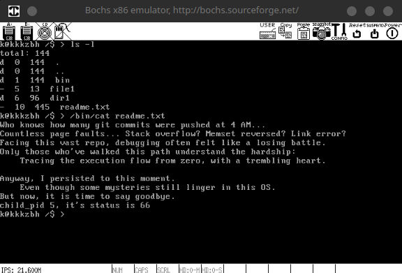
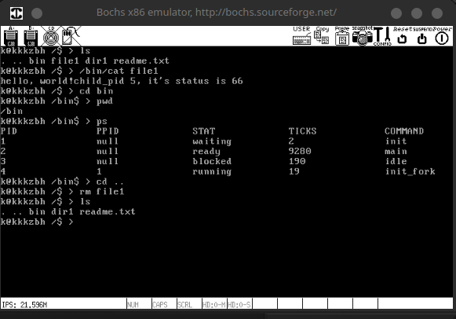
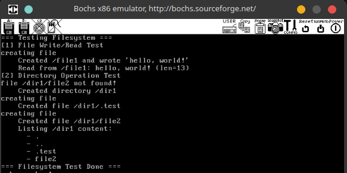
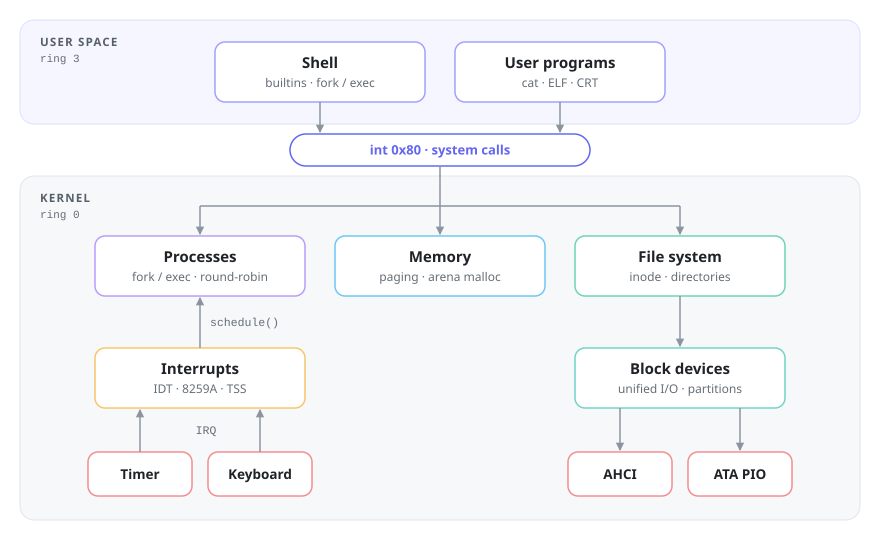

# knix

English | [简体中文](README.zh-CN.md)

A 32-bit x86 operating system written in **C++26 (Modules)**, from the boot sector all the way up to a user-space shell.


📖 Full design documentation (9 chapters, Chinese): <https://os.kkkzbh.cn>



## Features

- **Boot**: MBR → Loader → Kernel, switching from real mode to protected mode, enabling paging, and parsing the kernel ELF by hand
- **Memory**: two-level paging, 3G/1G user/kernel address split, bitmap-based physical memory pools, Arena small-block allocator
- **Processes**: PCB and kernel stack share one page, round-robin scheduling, semaphores / mutexes, `fork / exec / wait / exit`
- **Devices**: PCI enumeration, AHCI first with ATA PIO fallback, unified block device interface, MBR partition scanning
- **File system**: ext2-like inode file system with file I/O, directories, path resolution, and `stat`
- **User space**: 26 system calls (`int 0x80`), CRT, a user-mode shell that runs external programs such as `cat`
- **Engineering**: 43 automated CTest cases (boot / disk / file system), runs on both QEMU and Bochs, source-level debugging with GDB

## Quick Start

**Requirements**: GCC 15 (multilib), NASM, CMake ≥ 4.0.1, Ninja, Python 3, and QEMU or Bochs.

```bash
cmake -S . -B build -G Ninja
cmake --build build --target osbuild   # build and write the disk image
cmake --build build --target qemu      # or bochs
```

Once in the shell, try: `ls`, `pwd`, `ps`, `mkdir /tmp`, `cd /tmp`, `cat <file>`.

```bash
ctest --test-dir build --output-on-failure   # run the automated tests
cmake --build build --target qemu-gdb        # start paused, wait for GDB on :1234
```

| Shell builtins | File system tests |
| --- | --- |
|  |  |

## Architecture

<picture>
  <source media="(prefers-color-scheme: dark)" srcset="assets/readme/arch-en-dark.svg">
  
</picture>

Boot path: `BIOS → MBR(0x7C00) → Loader(0x900) → protected mode + paging → parse kernel ELF → main()`.
The kernel then initializes the IDT, memory, threads, console, keyboard, timer, storage, file system, and system calls in order, and finally creates the init process, which launches the shell.

## Design Highlights

### Memory Management

- **Address space**: the lower 3GB belongs to user processes; the upper 1GB (from `0xC0000000`) is mapped into every process's page tables, so kernel code is directly accessible in any process context.
- **Recursive page directory**: the last page directory entry points to the directory itself, so the kernel can reach any page table entry through a fixed virtual address without setting up extra mappings.

Before enabling paging, the Loader lays out the skeleton of the whole address space with three instructions:

```nasm
mov [PAGE_DIR_TABLE_POS + 0x000], eax  ; PDE 0    → identity-map the low 1MB so code keeps running across the paging switch
mov [PAGE_DIR_TABLE_POS + 0xc00], eax  ; PDE 768  → same page table; the kernel now runs above 0xC0000000
sub eax, 0x1000
mov [PAGE_DIR_TABLE_POS + 4092], eax   ; PDE 1023 → points to the page directory itself (recursive mapping)
```

- **Two-level allocation**: physical memory is split into a kernel pool and a user pool, both tracked by bitmaps; every user process also has its own virtual address bitmap. Requests of 1KB or less go to the Arena allocator, which cuts a page into fixed-size blocks in 7 size classes from 16B to 1024B and manages them with free lists; larger requests are served directly in whole pages. This keeps fragmentation low and both allocation and freeing fast.

Arena metadata sits at the start of the page, so `free` only needs to round the block address down to the page boundary to find its Arena and size class. No extra lookup structure is needed:

```cpp
struct arena {
    mem_block_desc* desc;   // which size class (16B / 32B / ... / 1024B)
    u32  cnt;               // large ? pages occupied : free blocks left
    bool large;
};

auto ofarena(mem_block* b) -> arena*
{
    return (arena*)((u32)b & 0xfffff000);
}
```

### Processes and Scheduling

- **PCB and kernel stack share one page**: the PCB sits at the bottom of the page and the kernel stack grows down from the top, so `esp & 0xFFFFF000` is the current task's PCB. No global "current" pointer is needed.

```cpp
auto running_thread() -> task*
{
    u32 esp;
    asm ("mov %%esp, %0" : "=g"(esp));
    return reinterpret_cast<task*>(esp & 0xfffff000);
}
```

- **Context switching takes only 15 lines of assembly**: following the ABI, it saves just the 4 callee-saved registers, stores the stack top in `cur->self_kstack`, switches to `next`'s stack, and the `ret` lands exactly where `next` was last switched out. A new thread's initial stack is built with the same layout, so its first scheduling "returns" straight into the thread entry function.

```nasm
switch_to:                  ; void switch_to(task* cur, task* next)
    push esi
    push edi
    push ebx
    push ebp
    mov eax, [esp + 20]     ; cur
    mov [eax], esp          ; cur->self_kstack = esp
    mov eax, [esp + 24]     ; next
    mov esp, [eax]          ; esp = next->self_kstack
    pop ebp
    pop ebx
    pop edi
    pop esi
    ret
```

- **Scheduling**: the 8253 PIT runs at 100Hz (counter value `1193180 / 100`), firing a timer interrupt every 10ms. The policy is round-robin, and `priority` decides how many ticks a task gets per slice: 31 for the main thread, 10 for the idle thread.

The timer interrupt only does accounting and triggers scheduling. Along the way it checks a stack magic number at the end of the PCB: since the PCB and kernel stack share a page, a stack overflow overwrites it first, so an overflow is caught on the next tick instead of turning into a baffling crash later:

```cpp
extern "C" auto intr_time_handler() -> void
{
    auto cur_thread = running_thread();
    ASSERT(cur_thread->stack_magic == 0x19870916);  // kernel stack overflow check
    ++cur_thread->elapsed_ticks;                    // CPU time shown by ps
    ++ticks;
    if(cur_thread->ticks == 0) {
        schedule();                                 // time slice used up
    } else {
        --cur_thread->ticks;
    }
}
```

`schedule()` uses the current thread's state to tell the two entry paths apart: if it is still `running`, its time slice ran out, so it goes back to the tail of the queue with a fresh slice; otherwise the thread blocked itself, stays off the ready queue, and whoever signals the event is responsible for waking it:

```cpp
auto schedule() -> void
{
    ASSERT(intr_get_status() == INTR_OFF);
    if(thread_ready_list.empty() and is_blocked(idle_thread->stu)) {
        thread_unblock(idle_thread);                // nothing runnable: wake idle (only if blocked / waiting / hanging)
    }
    auto cur = running_thread();
    if(cur->stu == thread_status::running) {        // time slice expired
        thread_ready_list.push_back(&cur->general_tag);
        cur->ticks = cur->priority;
        cur->stu = thread_status::ready;
    }                                               // otherwise it blocked itself; don't requeue
    auto next = find_task_by_general(thread_ready_list.front());
    thread_ready_list.pop_front();
    next->stu = thread_status::running;
    process_activate(next);                         // switch page tables + update esp0
    switch_to(cur, next);
}
```

A few details:

- `thread_unblock` inserts the woken thread at the **head** of the ready queue. Threads waiting on I/O or locks get to run soon after waking, which improves responsiveness at the cost of a single `push_front`.
- The idle thread normally keeps itself blocked and is only woken when the ready queue is empty. It then runs `sti; hlt`: interrupts must be enabled before halting, or the CPU would stay halted forever.
- `thread_block / thread_unblock / thread_yield` all modify the queues with interrupts disabled. On a single core, disabling interrupts is enough to guarantee atomicity.

- **Threads and processes are unified**: kernel threads and user processes share the same `task` structure; the only difference is whether `pgdir` is null. The scheduler does not distinguish them, and `process_activate` handles the difference on every switch:

```cpp
auto process_activate(task const* pthread) -> void
{
    auto pagedir_phy_addr = u32(0x100000);          // kernel thread: use the kernel page directory
    if(pthread->pgdir != nullptr) {                 // user process: use its own page directory
        pagedir_phy_addr = pgtable::addr_v2p((u32)pthread->pgdir);
    }
    asm volatile("movl %0, %%cr3" : : "r"(pagedir_phy_addr) : "memory");

    if(pthread->pgdir) {
        tss.update(pthread);                        // esp0 = top of the PCB's page
    }
}
```

- **A single TSS for the whole system**. Instead of x86 hardware task switching, it switches in software like Linux does; the TSS only tells the CPU where the kernel stack is on a ring 3 → ring 0 transition. That is why only user processes need `esp0` updated: kernel threads already run in ring 0, so interrupts cause no stack switch.
- **User processes share the kernel space**: when a page directory is created, entries 768–1023 (above `0xC0000000`) are copied from the kernel page directory as a whole, and the last entry is then pointed back at the new directory itself, so every process sees the same kernel.
- **How a new thread starts running**: `thread_create` fakes a `switch_to` frame on the kernel stack with the return address set to `kernel_thread`. On its first scheduling, the `ret` in `switch_to` "returns" there. `kernel_thread` first re-enables interrupts (`schedule()` runs with interrupts off) and then calls the real thread function.
- **Why `fork` returns 0 in the child**: same idea. The child's interrupt stack is copied from the parent; only the saved `eax` is changed to 0, and the `switch_to` return address is set to `intr_exit`. When the child is scheduled for the first time, it returns from the interrupt straight to the `fork()` call site in user space, with 0 as the return value.

```cpp
auto intr_0_stack = (intr_stack*)((u32)child_thread + PG_SIZE - sizeof(intr_stack));
intr_0_stack->eax = 0;                              // fork() returns 0 in the child
auto ret_addr = (u32*)intr_0_stack - 1;
*ret_addr = (u32)intr_exit;                         // after switch_to, go straight down the interrupt exit path
child_thread->self_kstack = (u32*)intr_0_stack - 5;
```

- **Synchronization**: the semaphore is the only primitive; the mutex and the RAII lock are layered on top of it.

```cpp
auto semaphore::acquire() -> void
{
    auto old_status = intr_disable();
    while(value == 0) {                             // while, not if: re-check after waking
        waiters.push_back(&running_thread()->general_tag);
        thread_block(thread_status::blocked);
    }
    --value;
    intr_set_status(old_status);
}

auto semaphore::release() -> void
{
    auto old_status = intr_disable();
    if(not waiters.empty()) {
        auto t = find_task_by_general(waiters.front());
        waiters.pop_front();
        thread_unblock(t);
    }
    ++value;
    intr_set_status(old_status);
}
```

  - The semaphore has Mesa semantics: `release` only wakes a waiter and does not hand the resource over to it. The woken thread has to compete again, so `acquire` must re-check in a `while` loop.
  - `mutex` is a semaphore initialized to 1 that also records its holder and a recursion count, so **the same thread can lock it again**: calling another function that needs the same lock while holding it does not deadlock.
  - `lock_guard<Mutex>` locks on construction and unlocks on destruction. It is used in 19 places in the kernel, so an early `return` never leaves a lock held.

```cpp
auto mutex::lock() -> void
{
    auto cur = running_thread();
    if(holder != cur) {
        sema.acquire();
        holder = cur;
        holder_repeat_nr = 1;
        return;
    }
    ++holder_repeat_nr;                             // reentrant
}

auto lcg = lock_guard{ get_mutex(pf) };             // as used in malloc
```

### Interrupts and System Calls

- The IDT has 129 entries: `0x00–0x1F` are CPU exceptions, `0x20–0x2F` are hardware interrupts forwarded by two cascaded 8259A PICs, and `0x80` is the system call gate. Page faults print `CR2` to make them easy to locate.
- User code traps into the kernel with `int 0x80`, with the call number in `eax` and arguments in `ebx / ecx / edx`. The user-side wrapper is a variadic template: `requires` limits the argument count at compile time, `if constexpr` picks the matching inline assembly, and C++26 pack indexing (`args...[0]`) binds each argument to its register, replacing the traditional `_syscall0/1/2/3` macros.

```cpp
template<typename... Args>
requires (sizeof...(Args) <= 3)
auto syscall(int num, Args... args) -> int
{
    int ret;
    if constexpr (sizeof...(Args) == 3) {
        asm volatile ("int $0x80"
            : "=a"(ret)
            : "a"(num), "b"(args...[0]), "c"(args...[1]), "d"(args...[2])
            : "memory");
    } // the 0 / 1 / 2 argument branches are analogous
    return ret;
}

auto write(i32 fd, void const* buf, u32 count) -> i32
{
    return syscall(+sysid::write, fd, buf, count);
}
```

### Devices and Storage

- **Block device abstraction**: a driver only implements and registers two function pointers, `read_blocks / write_blocks`. Partition scanning and the file system depend only on this interface and do not care which controller sits underneath.

```cpp
struct block_device {
    char name[8];
    u32  sector_size;
    u32  max_transfer;          // max sectors per transfer; drivers split requests by it (ATA 256 / AHCI 8)
    block_io_fn read_blocks;    // implemented separately by AHCI / ATA PIO
    block_io_fn write_blocks;
};
```

- **AHCI first, ATA PIO as fallback**: at boot, the kernel enumerates PCI looking for an AHCI controller and falls back to IDE PIO (LBA28) if none is found, so the same kernel boots under different emulator configurations.

```cpp
auto storage_init() -> void
{
    if(ahci_init()) {
        return;             // AHCI controller found; AHCI block device registered
    }
    ata_pio_init();         // otherwise fall back to ATA PIO
}
```

- **Keyboard**: the interrupt handler translates scan codes and writes them into a ring buffer; the shell blocks when reading from an empty buffer. A classic producer–consumer setup.

### File System

Partition layout: `boot block | super block | block bitmap | inode bitmap | inode table | data area`.

- An inode has 12 direct blocks plus 1 single-indirect block, so the maximum file size is `(12 + 128) × 512 = 70KB`. That is enough for now, and it keeps the implementation simple and straightforward.
- A directory is itself a file whose content is a list of `{name, inode number, type}` entries; every directory contains `.` and `..`.
- The kernel keeps a global open-file table and each process keeps its own fd table (0/1/2 reserved for stdin, stdout, and stderr). This two-level indirection lets parent and child share open files after `fork`.

```cpp
struct inode {
    u32 no;
    u32 size;
    u32 open_cnts;      // +1 on fork; released only when the last holder closes it
    u32 sectors[13];    // [0..11] direct blocks, [12] single-indirect block
};

struct dir_entry {
    char filename[16];
    u32  inode_no;
    file_type type;     // regular file / directory
};
```

### User Programs and the Shell

- User programs are compiled with GCC on the host and linked against the bundled CRT (which sets up `argc/argv` and calls `main` and `exit`). They are first written to the raw disk, then copied into the file system by the kernel.
- The shell runs in user mode: builtins such as `cd / ls / ps` execute inside the shell process, while external commands go through `fork → exec → wait`, just like the Unix model.

```cpp
auto pid = std::fork();
if(pid) {                                   // parent: wait for the child to exit and reap it
    int status;
    auto child_pid = std::wait(status);
    std::println("child_pid {}, it's status is {}", child_pid, status);
} else {                                    // child: replace itself with the target program
    make_clear_abs_path(argv[0], final_path.data());
    std::exec(argv[0], argv.data());
}
```

### Modern C++ in a Freestanding Environment

The kernel is built without any standard library (`-ffreestanding -nostdlib -fno-exceptions -fno-rtti`), so it ships its own small `std`.

**Modules organize all kernel code**: every subsystem is a module, dependencies are declared in the source, and there are no header-ordering or macro-pollution problems.

```cpp
export module malloc;

import schedule;
import arena;
import pool;
import lock_guard;

export auto malloc(size_t size) -> void*;
```

**Type-safe `print`**: the format string only marks positions; how each value is printed is decided by the `formatter<T>` for its type. At runtime, pack indexing dispatches the `idx`-th argument to the matching formatter. Unlike C varargs, no type information is erased, and passing the wrong type fails at compile time.

```cpp
template<size_t I = 0, typename... Args>
auto parse(char*& out, size_t idx, char c, Args&&... args) -> void
{
    if constexpr (I < sizeof...(Args)) {
        if(I == idx) {
            format<Args...[I]>::parse(out, args...[I], c);
        } else {
            parse<I + 1>(out, idx, c, static_cast<Args&&>(args)...);
        }
    }
}
```

Supporting a new printable type only takes a `formatter` specialization, and containers print directly:

```cpp
template<typename T>
struct std::formatter<std::vector<T>> {
    auto static parse(char*& out, vector<T> const& arg, char c) -> void
    {
        *out = '[';
        for(auto const& v : arg) {
            ++out;
            format<T>::parse(out, v, c);
            *out = ',';
        }
        *out++ = ']';
    }
};

std::println("fds = {}", fds);     // fds is a std::vector<i32>; prints fds = [0,1,2]
```

**Home-made ranges-style utilities**: using C++23 `static operator[]`, multidimensional subscripts, and deducing this, the kernel gets call syntax close to `std::ranges`, used throughout the codebase.

```cpp
for(auto i : std::iota[MAX_FILE_OPEN]) { ... }          // iterate over [0, N)
pthread->fd_table[3, MAX_FILES_OPEN_PER_PROC] | std::fill[-1];   // fill a subrange
argv | std::fill[nullptr];                              // clear the whole container
```

## Testing and Debugging

| Suite | Coverage |
| --- | --- |
| `boot.*` | Image layout check; boot milestones and shell prompt detection under QEMU |
| `disk.*` | Single-sector / cross-sector / multi-sector I/O, read-after-write, partition table scan, max-transfer boundary; both the ATA PIO and AHCI backends verified under QEMU and Bochs |
| `fs.*` | File and directory system calls, error paths, shell commands, persistence across reboots, regressions for past bugs |

Test scripts prepare disk images on the host, boot QEMU headless, and judge results from serial output. Debug builds generate `-g3` debug info for the kernel, enabling source-level stepping through `qemu-gdb` / `bochs-gdb`.

## Notable Problems Solved During Development

- **Mysterious page faults**: the kernel entry did not zero `.bss`, so uninitialized global objects (memory pool bitmaps, linked lists) held leftover data. After adding `clear_bss()` before global constructors run, a whole class of hard-to-reproduce #PFs disappeared.
- **Kernel failing to load as it grew**: as the kernel grew, the sector count written to the image in CMake kept going up, until booting started failing in strange ways. Debugging showed that the ATA sector count register (`0x1F2`) is only 8 bits wide and `out dx, al` writes only the low byte of the count: 300 (`0x12C`), for example, actually requested just 44 sectors, while the Loader still read 300 sectors' worth from the data port and ended up with an incomplete kernel. The fix was to split loading into two reads (255 sectors first, then the rest), keeping each request within what 8 bits can express. Later, when the ATA PIO driver was rewritten, this hardware constraint moved inside the driver: requests are split automatically by `max_transfer = 256`, with 256 encoded as register value 0, so upper layers never need to care about it again.
- **Global constructor timing**: some global constructors performed I/O, but they ran before the hardware was initialized. Initialization was changed to explicit calls (`xxx_init()`), and constructors no longer have side effects.
- **The return value of `wait`**: system calls pass arguments only through registers, so the status code could not be written back "by reference". The fix was for user space to pass a pointer that the kernel writes into directly.
- **Waking the idle thread**: when the ready queue was empty, the scheduler woke idle unconditionally, but idle might already be ready or running, so it got queued twice. The fix checks whether idle is in a blocked state before waking it.

## Limitations

Single core; 32-bit only; no preemptive priority scheduling; files are limited to about 70KB; no dynamic linking and no signals.

## Project Structure

```text
boot/      MBR, Loader (NASM)
kernel/    kernel entry, interrupts, and the subsystems under module/
  module/  memory · thread · user(syscall) · filesystem · shell · std · program
device/    pci · ahci · ata_pio · block · keyboard · time · console · ioqueue
tests/     CTest: boot / disk / fs suites and image preparation scripts
scripts/   QEMU / Bochs launch and debugging scripts
```
