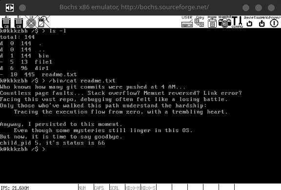
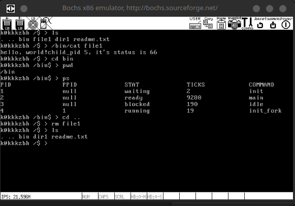
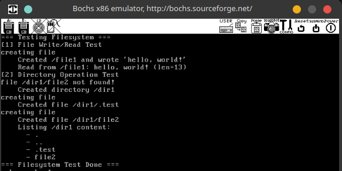
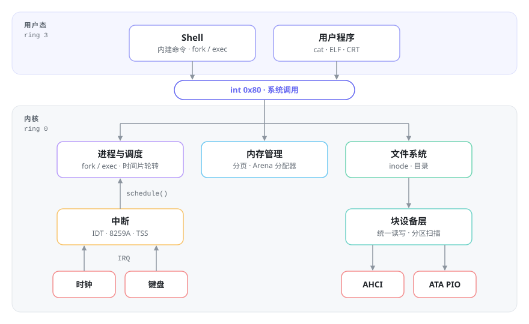

# knix

[English](README.md) | 简体中文

一个用 **C++26（Modules）** 从引导扇区写到用户态 Shell 的 32 位 x86 操作系统。


📖 完整设计文档（9 章）：<https://os.kkkzbh.cn>



## 特性

- **启动**：MBR → Loader → Kernel，自己完成实模式到保护模式、开启分页、解析内核 ELF
- **内存**：二级分页、3G/1G 用户/内核地址空间划分、位图物理内存池、Arena 小块分配器
- **进程**：PCB 与内核栈同页、时间片轮转调度、信号量 / 互斥锁、`fork / exec / wait / exit`
- **设备**：PCI 枚举，AHCI 优先、ATA PIO 回退，统一块设备接口，MBR 分区扫描
- **文件系统**：类 ext2 的 inode 文件系统，支持文件读写、目录、路径解析、`stat`
- **用户态**：26 个系统调用（`int 0x80`）、CRT、用户态 Shell，可运行 `cat` 等外部程序
- **工程化**：CTest 自动化测试（启动 / 磁盘 / 文件系统共 43 项），QEMU、Bochs 双模拟器，GDB 源码级调试

## 快速开始

**依赖**：GCC 15（multilib）、NASM、CMake ≥ 4.0.1、Ninja、Python 3，以及 QEMU 或 Bochs。

```bash
cmake -S . -B build -G Ninja
cmake --build build --target osbuild   # 编译并写入磁盘镜像
cmake --build build --target qemu      # 或 bochs
```

进入 Shell 后可以试试：`ls`、`pwd`、`ps`、`mkdir /tmp`、`cd /tmp`、`cat <file>`。

```bash
ctest --test-dir build --output-on-failure   # 运行自动化测试
cmake --build build --target qemu-gdb        # 启动后挂起，等待 GDB 连接 :1234
```

| Shell 内建命令 | 文件系统测试 |
| --- | --- |
|  |  |

## 架构

<picture>
  <source media="(prefers-color-scheme: dark)" srcset="assets/readme/arch-zh-dark.svg">
  
</picture>

启动链路：`BIOS → MBR(0x7C00) → Loader(0x900) → 保护模式 + 分页 → 解析 kernel ELF → main()`，
随后依次初始化 IDT、内存、线程、控制台、键盘、时钟、存储、文件系统、系统调用，最后创建 init 进程并拉起 Shell。

## 设计要点

### 内存管理

- **地址空间**：低 3GB 给用户进程，高 1GB（`0xC0000000` 起）映射到每个进程的页表中，因此内核代码在任何进程上下文里都能直接访问。
- **页表自映射**：页目录最后一项指向自己，内核修改任意页表项时不需要额外映射，直接通过固定虚拟地址就能访问。

Loader 开启分页前，用三条指令搭好整个地址空间的骨架：

```nasm
mov [PAGE_DIR_TABLE_POS + 0x000], eax  ; PDE 0   → 低 1MB 恒等映射，保证开启分页前后的代码都能继续执行
mov [PAGE_DIR_TABLE_POS + 0xc00], eax  ; PDE 768 → 同一张页表，内核从此运行在 0xC0000000 以上
sub eax, 0x1000
mov [PAGE_DIR_TABLE_POS + 4092], eax   ; PDE 1023 → 指向页目录自己（自映射）
```

- **两级分配**：物理内存分为内核池和用户池，用位图管理；每个用户进程还有自己的虚拟地址位图。小于等于 1KB 的申请走 Arena：把一页切成 16B ~ 1024B 共 7 种规格的块，用空闲链表管理；更大的申请直接按页分配。这样既减少碎片，分配和释放也都很快。

Arena 的元数据放在页首，所以 `free` 时只要把块地址按页对齐，就能找到它所属的 Arena 和规格，不需要额外的查找结构：

```cpp
struct arena {
    mem_block_desc* desc;   // 属于哪种规格（16B / 32B / ... / 1024B）
    u32  cnt;               // large ? 占用的页数 : 剩余空闲块数
    bool large;
};

auto ofarena(mem_block* b) -> arena*
{
    return (arena*)((u32)b & 0xfffff000);
}
```

### 进程与调度

- **PCB 与内核栈放在同一页**：PCB 在页底，内核栈从页顶向下增长，所以 `esp & 0xFFFFF000` 就是当前任务的 PCB，不需要维护全局 "current" 指针。

```cpp
auto running_thread() -> task*
{
    u32 esp;
    asm ("mov %%esp, %0" : "=g"(esp));
    return reinterpret_cast<task*>(esp & 0xfffff000);
}
```

- **上下文切换只有 15 行汇编**：按 ABI 约定只保存被调用者保存的 4 个寄存器，把栈顶记到 `cur->self_kstack`，再换成 `next` 的栈，`ret` 之后就回到了 `next` 上次被切走的位置。新线程的初始栈也按这个布局构造，所以第一次被调度时会直接"返回"到线程入口函数。

```nasm
switch_to:                  ; void switch_to(task* cur, task* next)
    push esi
    push edi
    push ebx
    push ebp
    mov eax, [esp + 20]     ; cur
    mov [eax], esp          ; cur->self_kstack = esp
    mov eax, [esp + 24]     ; next
    mov esp, [eax]          ; esp = next->self_kstack
    pop ebp
    pop ebx
    pop edi
    pop esi
    ret
```

- **调度**：8253 PIT 设为 100Hz（计数初值 `1193180 / 100`），每 10ms 触发一次时钟中断。策略是时间片轮转，`priority` 决定每次分到多少个 tick：main 线程 31，idle 线程 10。

时钟中断只负责记账和触发调度。顺带检查 PCB 末尾的栈魔数：PCB 和内核栈在同一页，栈一旦溢出最先覆盖的就是它，这样溢出能在下一个 tick 被发现，而不是演变成一个莫名其妙的崩溃：

```cpp
extern "C" auto intr_time_handler() -> void
{
    auto cur_thread = running_thread();
    ASSERT(cur_thread->stack_magic == 0x19870916);  // 内核栈溢出检测
    ++cur_thread->elapsed_ticks;                    // ps 里显示的 CPU 时间
    ++ticks;
    if(cur_thread->ticks == 0) {
        schedule();                                 // 时间片用完
    } else {
        --cur_thread->ticks;
    }
}
```

`schedule()` 通过当前线程的状态区分两种进入方式：如果还是 `running`，说明是时间片到了，放回队尾并重置时间片；否则是线程主动阻塞，不放回就绪队列，由事件发生方负责唤醒：

```cpp
auto schedule() -> void
{
    ASSERT(intr_get_status() == INTR_OFF);
    if(thread_ready_list.empty() and is_blocked(idle_thread->stu)) {
        thread_unblock(idle_thread);                // 没有可运行的任务，唤醒 idle（blocked / waiting / hanging 时才唤醒）
    }
    auto cur = running_thread();
    if(cur->stu == thread_status::running) {        // 时间片到了
        thread_ready_list.push_back(&cur->general_tag);
        cur->ticks = cur->priority;
        cur->stu = thread_status::ready;
    }                                               // 否则是主动阻塞，不放回队列
    auto next = find_task_by_general(thread_ready_list.front());
    thread_ready_list.pop_front();
    next->stu = thread_status::running;
    process_activate(next);                         // 切页表 + 更新 esp0
    switch_to(cur, next);
}
```

几个细节：

- `thread_unblock` 把被唤醒的线程插到就绪队列**头部**。等 I/O、等锁的线程醒来后能尽快运行，交互响应更好，代价只是改了一行 `push_front`。
- idle 线程平时把自己阻塞起来，只有就绪队列为空时才被唤醒。唤醒后执行 `sti; hlt`，必须先开中断再停机，否则 CPU 会永远停在那里。
- `thread_block / thread_unblock / thread_yield` 都在关中断的状态下修改队列。单核环境下，关中断就足以保证原子性。

- **线程与进程统一**：内核线程和用户进程都用同一个 `task` 结构，区别只在于 `pgdir` 是否为空。调度器不区分两者，切换时由 `process_activate` 处理差异：

```cpp
auto process_activate(task const* pthread) -> void
{
    auto pagedir_phy_addr = u32(0x100000);          // 内核线程：使用内核页目录
    if(pthread->pgdir != nullptr) {                 // 用户进程：使用自己的页目录
        pagedir_phy_addr = pgtable::addr_v2p((u32)pthread->pgdir);
    }
    asm volatile("movl %0, %%cr3" : : "r"(pagedir_phy_addr) : "memory");

    if(pthread->pgdir) {
        tss.update(pthread);                        // esp0 = PCB 所在页的页顶
    }
}
```

- **全系统只有一个 TSS**。没有使用 x86 的硬件任务切换，而是和 Linux 一样做软件切换，TSS 只用来在 ring 3 → ring 0 时告诉 CPU 内核栈在哪里。因此只有用户进程需要更新 `esp0`；内核线程本来就在 ring 0，中断时不会发生栈切换。
- **用户进程共享内核空间**：创建页目录时，把内核页目录的第 768~1023 项（`0xC0000000` 以上）整体复制过来，再把最后一项改成指向自己，所有进程看到的都是同一份内核。
- **新线程如何开始运行**：`thread_create` 在内核栈上伪造一份 `switch_to` 的现场，返回地址设为 `kernel_thread`。第一次被调度时，`switch_to` 的 `ret` 就会"返回"到这里。`kernel_thread` 先开中断（`schedule()` 运行在关中断状态下），再调用真正的线程函数。
- **`fork` 为什么在子进程里返回 0**：同样的思路。子进程的中断栈从父进程复制而来，只把其中保存的 `eax` 改成 0，并把 `switch_to` 的返回地址设为 `intr_exit`。子进程第一次被调度时，直接从中断返回到用户态的 `fork()` 调用点，拿到的返回值就是 0。

```cpp
auto intr_0_stack = (intr_stack*)((u32)child_thread + PG_SIZE - sizeof(intr_stack));
intr_0_stack->eax = 0;                              // 子进程的 fork() 返回 0
auto ret_addr = (u32*)intr_0_stack - 1;
*ret_addr = (u32)intr_exit;                         // switch_to 返回后直接走中断退出路径
child_thread->self_kstack = (u32*)intr_0_stack - 5;
```

- **同步**：信号量是唯一的基础原语，互斥锁和 RAII 锁都在它之上逐层封装。

```cpp
auto semaphore::acquire() -> void
{
    auto old_status = intr_disable();
    while(value == 0) {                             // while 而不是 if：醒来后要重新检查
        waiters.push_back(&running_thread()->general_tag);
        thread_block(thread_status::blocked);
    }
    --value;
    intr_set_status(old_status);
}

auto semaphore::release() -> void
{
    auto old_status = intr_disable();
    if(not waiters.empty()) {
        auto t = find_task_by_general(waiters.front());
        waiters.pop_front();
        thread_unblock(t);
    }
    ++value;
    intr_set_status(old_status);
}
```

  - 信号量是 Mesa 语义：`release` 只负责唤醒，不把资源直接交给被唤醒的线程。醒来的线程要和其他线程重新竞争，所以 `acquire` 里必须用 `while` 重新检查。
  - `mutex` 是初值为 1 的信号量，另外记录持有者和重入次数，**同一线程可以重复加锁**：持锁期间再调用同样需要这把锁的函数时，不会把自己锁死。
  - `lock_guard<Mutex>` 在构造时加锁、析构时解锁。内核里有 19 处使用，提前 `return` 时也不会忘记解锁。

```cpp
auto mutex::lock() -> void
{
    auto cur = running_thread();
    if(holder != cur) {
        sema.acquire();
        holder = cur;
        holder_repeat_nr = 1;
        return;
    }
    ++holder_repeat_nr;                             // 可重入
}

auto lcg = lock_guard{ get_mutex(pf) };             // malloc 中的用法
```

### 中断与系统调用

- IDT 共 129 项：`0x00–0x1F` 是 CPU 异常，`0x20–0x2F` 是两片级联 8259A 转发的硬件中断，`0x80` 是系统调用。缺页时会打印 `CR2`，方便定位。
- 用户态通过 `int 0x80` 陷入内核，调用号放在 `eax`，参数放在 `ebx / ecx / edx`。用户侧的封装是一个变参模板：`requires` 在编译期限制参数个数，`if constexpr` 选出对应的内联汇编，C++26 的包索引（`args...[0]`）把每个参数绑定到对应寄存器，替代了传统写法里 `_syscall0/1/2/3` 四个宏。

```cpp
template<typename... Args>
requires (sizeof...(Args) <= 3)
auto syscall(int num, Args... args) -> int
{
    int ret;
    if constexpr (sizeof...(Args) == 3) {
        asm volatile ("int $0x80"
            : "=a"(ret)
            : "a"(num), "b"(args...[0]), "c"(args...[1]), "d"(args...[2])
            : "memory");
    } // 0 / 1 / 2 个参数的分支同理
    return ret;
}

auto write(i32 fd, void const* buf, u32 count) -> i32
{
    return syscall(+sysid::write, fd, buf, count);
}
```

### 设备与存储

- **块设备抽象**：驱动只需要实现 `read_blocks / write_blocks` 两个函数指针并注册，分区扫描和文件系统都只依赖这个接口，不关心底层是哪种控制器。

```cpp
struct block_device {
    char name[8];
    u32  sector_size;
    u32  max_transfer;          // 单次最大传输扇区数，驱动内部按它自动分批（ATA 256 / AHCI 8）
    block_io_fn read_blocks;    // AHCI / ATA PIO 各自实现
    block_io_fn write_blocks;
};
```

- **AHCI 优先，ATA PIO 兜底**：启动时先通过 PCI 枚举寻找 AHCI 控制器，找不到再回退到 IDE PIO（LBA28），同一套内核在不同模拟器配置下都能启动。

```cpp
auto storage_init() -> void
{
    if(ahci_init()) {
        return;             // 找到 AHCI 控制器，注册 AHCI 块设备
    }
    ata_pio_init();         // 否则回退到 ATA PIO
}
```

- **键盘**：中断处理程序把扫描码转换后写入环形缓冲区，Shell 读取时缓冲区为空就阻塞，是典型的生产者–消费者模型。

### 文件系统

分区布局：`引导块 | 超级块 | 块位图 | inode 位图 | inode 表 | 数据区`。

- inode 使用 12 个直接块加 1 个一级间接块，单文件最大 `(12 + 128) × 512 = 70KB`。目前够用，换来的是实现简单直接。
- 目录本身也是文件，内容就是一组 `{文件名, inode 号, 类型}` 目录项，每个目录都包含 `.` 和 `..`。
- 内核维护全局打开文件表，进程维护自己的 fd 表（0/1/2 预留给标准输入、输出和错误），两级间接让 `fork` 之后父子进程可以共享已打开的文件。

```cpp
struct inode {
    u32 no;
    u32 size;
    u32 open_cnts;      // fork 时 +1，最后一个持有者 close 时才真正释放
    u32 sectors[13];    // [0..11] 直接块，[12] 一级间接块
};

struct dir_entry {
    char filename[16];
    u32  inode_no;
    file_type type;     // 普通文件 / 目录
};
```

### 用户程序与 Shell

- 用户程序在宿主机上用 GCC 编译，链接自带的 CRT（负责准备 `argc/argv`、调用 `main` 和 `exit`），先写入裸盘，再由内核搬运到文件系统中。
- Shell 运行在用户态：`cd / ls / ps` 等内建命令在 Shell 进程内直接执行，外部命令走 `fork → exec → wait`，和 Unix 的模型一致。

```cpp
auto pid = std::fork();
if(pid) {                                   // 父进程：等待子进程退出并回收
    int status;
    auto child_pid = std::wait(status);
    std::println("child_pid {}, it's status is {}", child_pid, status);
} else {                                    // 子进程：换成目标程序
    make_clear_abs_path(argv[0], final_path.data());
    std::exec(argv[0], argv.data());
}
```

### 在 freestanding 环境里使用现代 C++

内核编译时不链接任何标准库（`-ffreestanding -nostdlib -fno-exceptions -fno-rtti`），所以自己实现了一套小型 `std`。

**Modules 组织全部内核代码**：每个子系统都是一个模块，依赖关系写在源码里，没有头文件包含顺序和宏污染的问题。

```cpp
export module malloc;

import schedule;
import arena;
import pool;
import lock_guard;

export auto malloc(size_t size) -> void*;
```

**类型安全的 `print`**：格式串只负责标记位置，具体怎么输出由参数类型的 `formatter<T>` 决定。运行时用包索引按下标把第 `idx` 个参数分发给对应的 formatter，没有可变参数列表那样的类型擦除，传错类型会在编译期报错。

```cpp
template<size_t I = 0, typename... Args>
auto parse(char*& out, size_t idx, char c, Args&&... args) -> void
{
    if constexpr (I < sizeof...(Args)) {
        if(I == idx) {
            format<Args...[I]>::parse(out, args...[I], c);
        } else {
            parse<I + 1>(out, idx, c, static_cast<Args&&>(args)...);
        }
    }
}
```

新增一种可打印类型只需要特化 `formatter`，容器也能直接打印：

```cpp
template<typename T>
struct std::formatter<std::vector<T>> {
    auto static parse(char*& out, vector<T> const& arg, char c) -> void
    {
        *out = '[';
        for(auto const& v : arg) {
            ++out;
            format<T>::parse(out, v, c);
            *out = ',';
        }
        *out++ = ']';
    }
};

std::println("fds = {}", fds);     // fds 是 std::vector<i32>，输出 fds = [0,1,2]
```

**自制的 ranges 风格工具**：利用 C++23 的 `static operator[]`、多参数下标和 deducing this，写出接近 `std::ranges` 的调用方式，在内核里随处使用。

```cpp
for(auto i : std::iota[MAX_FILE_OPEN]) { ... }          // 遍历 [0, N)
pthread->fd_table[3, MAX_FILES_OPEN_PER_PROC] | std::fill[-1];   // 子区间填充
argv | std::fill[nullptr];                              // 整个容器清空
```

## 测试与调试

| 测试集 | 内容 |
| --- | --- |
| `boot.*` | 镜像布局检查；QEMU 中启动里程碑和 Shell 提示符检测 |
| `disk.*` | 单扇区 / 跨扇区 / 多扇区读写、写后读、分区表扫描、最大传输边界；ATA PIO 和 AHCI 两个后端分别在 QEMU 与 Bochs 下验证 |
| `fs.*` | 文件和目录系统调用、错误路径、Shell 命令、重启后数据持久化、历史 bug 回归 |

测试脚本先在宿主机上准备磁盘镜像，再以 headless 方式启动 QEMU，并根据串口输出判断结果。Debug 构建会为内核生成 `-g3` 调试信息，可以通过 `qemu-gdb` / `bochs-gdb` 做源码级单步调试。

## 开发中解决的几个典型问题

- **神秘的缺页异常**：内核入口没有清零 `.bss`，未初始化的全局对象（内存池位图、链表）里是残留数据。在全局构造函数执行之前补上 `clear_bss()` 之后，一大批无法稳定复现的 #PF 都消失了。
- **内核变大后加载失败**：内核体积不断增长，CMake 写入镜像的扇区数也跟着调大，到后面启动开始出现莫名其妙的问题。排查后发现，ATA 的扇区数寄存器（`0x1F2`）只有 8 位，`out dx, al` 只会写入计数的低字节：比如 300（`0x12C`）实际只请求了 44 个扇区，而 Loader 仍然按 300 个扇区去读数据端口，读到的内核是不完整的。修复方法是把加载拆成两次（先读 255 个扇区，再读剩余部分），保证每次请求的扇区数都不超过 8 位能表示的范围。后来重写 ATA PIO 驱动时，把这个硬件约束收进了驱动内部：按 `max_transfer = 256` 自动分批，并把 256 编码成寄存器值 0，上层再也不用关心这个限制。
- **全局对象构造时机**：全局变量的构造函数里做了 I/O，而这些构造发生在硬件初始化之前。后来把初始化改为显式调用（`xxx_init()`），构造函数里不再有副作用。
- **`wait` 的返回值**：系统调用只能通过寄存器传参，状态码无法"按引用"写回，因此改为由用户态传入指针、内核直接写入。
- **idle 线程唤醒**：就绪队列为空时，调度器会无条件唤醒 idle，但 idle 此时可能已经处于就绪或运行状态，结果被重复加入队列。修复方法是先检查 idle 是否处于阻塞类状态，再决定是否唤醒。

## 局限

单核；32 位；没有抢占式优先级调度；单文件上限约 70KB；没有动态链接，也没有信号机制。

## 项目结构

```text
boot/      MBR、Loader（NASM）
kernel/    内核入口、中断，以及 module/ 下的各子系统
  module/  memory · thread · user(syscall) · filesystem · shell · std · program
device/    pci · ahci · ata_pio · block · keyboard · time · console · ioqueue
tests/     CTest：boot / disk / fs 测试集与镜像准备脚本
scripts/   QEMU / Bochs 启动与调试脚本
```
